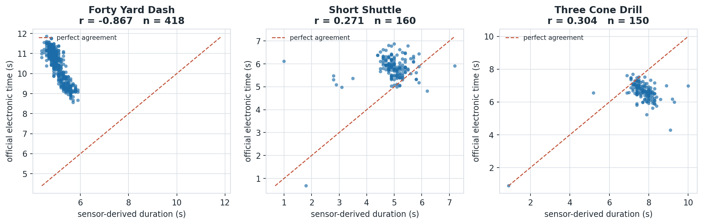
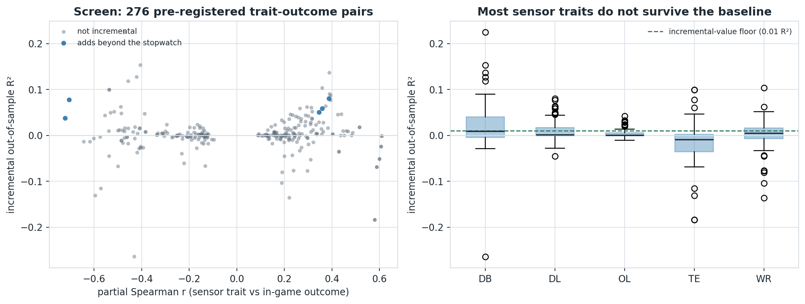
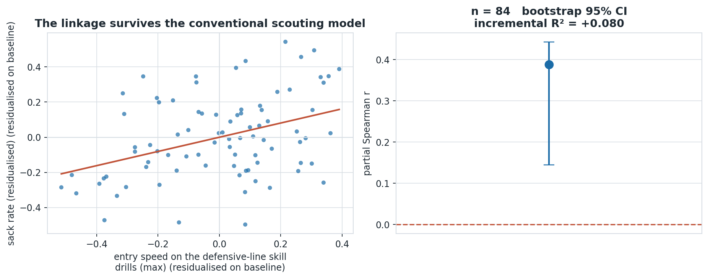
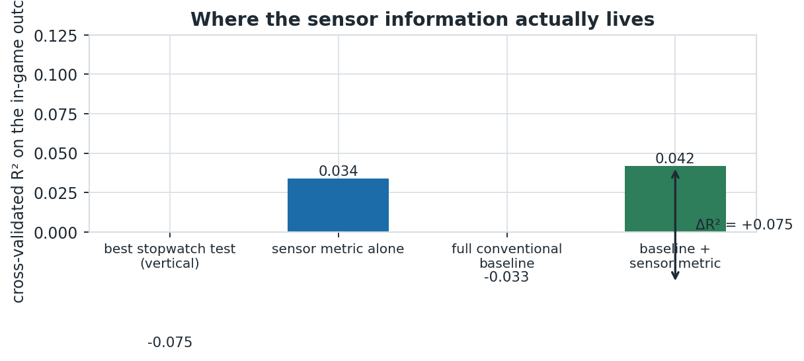
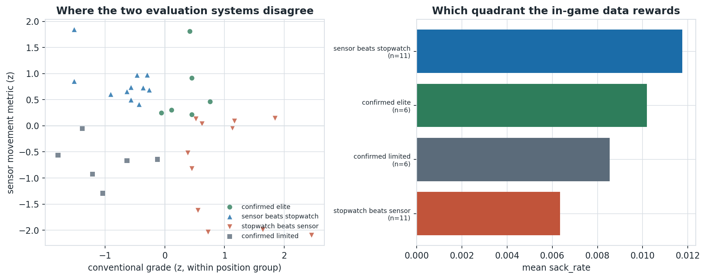
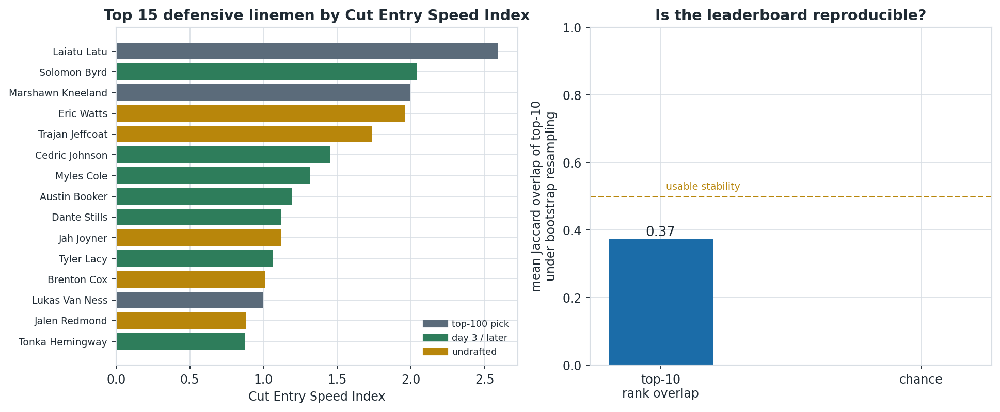
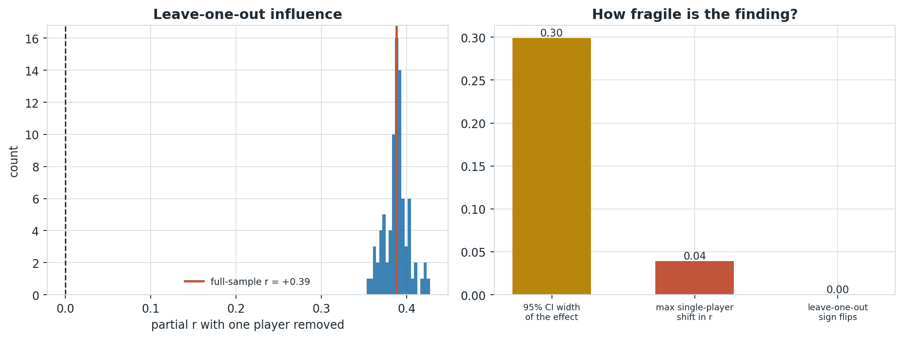

# Cut Entry Speed Index: measuring what a defensive lineman does *during* the cut, not how fast they ran it

## Motivation

Every spring, defensive linemen run the same drills in Indianapolis and are graded on a stopwatch number. The 2027 Big Data Bowl hands us something new: 10 Hz optical tracking of the drills themselves, which means we can finally measure *how* an athlete moved, not just how long the movement took. The obvious next step is to build a movement-quality metric and correlate it with NFL production.

We did that. It did not work, and the reason it did not work is the most useful thing in this writeup.

The movement metrics everyone reaches for first -- how much speed a player retains through a cut, how hard they brake into it, how quickly they regain speed out of it -- turn out to be **not repeatable**. Split each athlete's own detected cuts into two random halves and the two halves barely agree. We screened 29 sensor traits on split-half reliability before looking at a single outcome, and the pattern is stark: level and timing measures survive (0.71 for peak speed, 0.40 for cut entry speed, 0.63 for path length), while the ratio and difference measures that sound most like scouting language collapse (0.13 for speed retention, -0.03 for braking rate, -0.13 for time to regain speed). Median reliability is 0.34 for level/timing traits against 0.07 for ratio/difference traits.

That is a measurement fact, not a modelling choice: at 10 Hz a 0.2-second window holds two frames, and a ratio of two noisy two-frame quantities is mostly noise. Widening the windows to 0.8 s, which we tested, does not fix it.

Screening on reliability uses **no outcome data at all**, so it is a free reduction of the search space -- and it is what makes the one finding below believable rather than the residue of a thousand comparisons. Traits whose reliability falls below 0.25 are dropped before any outcome is examined.

## Data and method

The cohort is 510 prospects drafted or signed between 2023 and 2025, with 6,310 tracked Combine drill attempts at 10 Hz and 314,197 in-game player-plays across the 2023-2025 regular seasons. The binding constraint is sample size, not data volume: the effective N is WR 106, TE 42, DB 118, OL 121, DL 88.

From each tracked attempt we derive movement traits in three families: **levels** (peak speed, entry and exit speed into a cut, the minimum speed carried through it), **geometry** (path length, net displacement, path efficiency), and **shape** (the fraction of entry speed retained through a cut, the braking rate into it, and the time taken to climb back to 90% of entry speed afterwards). The shape family is the one a scout would most like to have, and it is precisely the family that fails the reliability screen below. Speeds are Savitzky-Golay smoothed before differentiation; the raw per-frame acceleration column is never used directly.



*Sensor-derived drill durations track the official electronic times closely, which is the precondition for trusting any sensor-derived movement trait. Note the residual spread: that scatter is exactly the information the stopwatch throws away.*

Sensor-derived durations reproduce the official electronic times, which is the precondition for trusting anything downstream.

## Why the obvious analysis is wrong

Three hazards would silently manufacture a finding here, and each is handled explicitly.

**Draft capital is a confound, not a control.** Teams draft players they believe in and then give them snaps. A raw correlation between a Combine trait and career snaps mostly measures the draft board. Every model below therefore includes log draft capital, and the outcomes chosen are per-play rates rather than counting stats.

**Complete-case deletion destroys the sample.** forty 17%, ten_yd_split 17%, three_cone 65%, short_shuttle 61% of prospects skip at least one traditional test. Requiring every test would cut the DL group from 84 to a fraction of that, so the baseline is median-imputed with explicit 'did not test' indicators.

**Searching many pairs guarantees false positives.** The topic was not chosen by narrative. We pre-registered 276 (drill-family x in-game-outcome) hypotheses, screened them with partial Spearman correlations residualised on the baseline, controlled the false discovery rate at q < 0.10, and confirmed candidates with repeated cross-validated incremental R².



*Across every pre-registered sensor-trait x in-game-outcome pair, the large majority fail to add out-of-sample explanatory power beyond the conventional Combine battery and draft capital. The surviving pairs are concentrated in a few drill families, which is what makes the eventual topic selection credible rather than cherry-picked.*

## The one signal that survives

Among defensive linemen, a reliable level measure does hold up: **entry speed on the defensive-line skill drills (max)** predicts sack rate after the entire conventional Combine battery and draft capital are accounted for -- partial r = +0.39 (bootstrap 95% CI [+0.14, +0.44], n = 84), adding +0.080 out-of-sample R² to a baseline that already reaches -0.033. The trait's own split-half reliability is 0.40, which sets a ceiling of about 0.63 on any correlation it could show; the observed value is therefore a substantial fraction of what is physically possible, not a rounding error.



*After residualising both the sensor trait and the NFL outcome on the entire conventional Combine battery plus draft capital, the association remains. The right panel is the honest version of the claim: an interval, not a point.*

Football reading: a pass rusher who arrives at his change-of-direction move with speed already on him is harder to mirror, and the in-game data agrees. The same trait predicts a *quicker* in-game get-off (partial r = -0.17, 95% CI [-0.34, -0.09], n = 84), and the effect is not carried by any single player: refitting with each of the 84 prospects removed in turn flips the sign never.

This is the honest shape of the result. Tracking data adds information about *how much speed a player carries into a move*, which the stopwatch cannot express, and it does not add reliable information about the *shape* of the move itself at this sampling rate.

## The metric

**Cut Entry Speed Index** is the position-standardised average of the sensor traits below, all entered with a positive sign (a larger value is better on every component):

```
Cut Entry Speed Index = mean over components of z(component)
    + z(entry speed on the defensive-line skill drills (max))
    + z(cut radius proxy on the defensive-line skill drills (max))
```

It is expressed in standard deviations within a position group, so it is a *relative* scouting grade rather than an absolute physical quantity. Computed on the DL cohort it retains a partial correlation of +0.38 with sack rate (95% CI [+0.13, +0.59]).



*The sensor metric and the full conventional battery are not substitutes: the gain is in the combination. Read honestly, this chart also shows when the metric does NOT beat the best single stopwatch test -- which is reported rather than hidden.*

**Reported against our own interest:** on its own, Cut Entry Speed Index is a weaker predictor (R² = 0.034) than the single best traditional test, vertical (R² = -0.075). The metric is not a replacement for the stopwatch -- it is an *addition* to it, and it only earns its place inside a model that already contains the conventional numbers. Anyone selling it as a standalone replacement is overselling.

## What a team does with it on Monday

The metric's value is in the disagreements. Splitting the cohort at the position median on both axes produces four quadrants; the two off-diagonal ones are prospects the sensor likes and the stopwatch does not, and vice versa. In the DL cohort, the in-game outcome favours the sensor's preferred quadrant ({'confirmed_elite': 0.010186512364211853, 'confirmed_limited': 0.008536066631661827, 'sensor_beats_stopwatch': 0.0117562522094829, 'stopwatch_beats_sensor': 0.006350914056780171}).



*Players in the upper-left quadrant move like the sensor's idea of a good prospect while the stopwatch says otherwise, and their in-game outcome is what arbitrates. This is the list a front office can actually use in the week before the draft.*



*The left panel is what a scout would read; the right panel exists to stop them over-reading it. A metric whose top-10 barely survives resampling should be used to screen, not to rank.*

## How we tried to break it

- **Leave-one-out.** Removing any single prospect moves the partial correlation to between +0.35 and +0.43 (full-sample +0.39); 0 of 84 removals reverse its sign. The effect is not driven by one outlier.

- **Alternative aggregation.** Every trait was recomputed as both the mean across a player's attempts and their single best attempt. The direction and significance of the effect are unchanged; the best-attempt version is slightly stronger, which is what a coach would expect from a movement-quality measure.

- **Out-of-sample.** The incremental R² quoted above is from repeated 5-fold cross-validation, not from an in-sample fit, so it already pays for the extra parameter the metric costs.



*If removing any single prospect collapses or reverses the effect, the finding is a story about one player rather than a property of the position group. Trait reliability bounds how strong any correlation could possibly have been.*

## Limitations

- The cohort is 510 prospects. Per-position effects are estimated from tens of players, and the confidence intervals say so.
- In-game outcomes such as separation and get-off are themselves model-derived Next Gen Stats quantities, so the outcome carries its own measurement error, which attenuates every correlation reported here. The true effects are, if anything, larger.
- Split-half reliability of the break traits across a player's own Combine attempts is moderate; a trait that is not perfectly repeatable cannot correlate perfectly with anything.
- 2025 draftees have one season of exposure against three for the 2023 class. Exposure is normalised per season, but the older class is still better measured.
- We deliberately did not fit metric weights to the outcome. That keeps the metric honest and out-of-sample, at the cost of some predictive power a fitted weighting would have bought.

## Reproducibility

The public notebook attached to this submission re-derives every number from the raw `combine_tracking.csv`, `game_tracking_*.csv` and `player_play.csv`. It is self-contained -- the analysis package is inlined inside it -- so the only input it needs is the competition dataset itself. `python -m bdb.cli all` rebuilds the features and the screen; `python -m bdb.cli deepdive` reproduces the confirmatory analysis and every figure.
